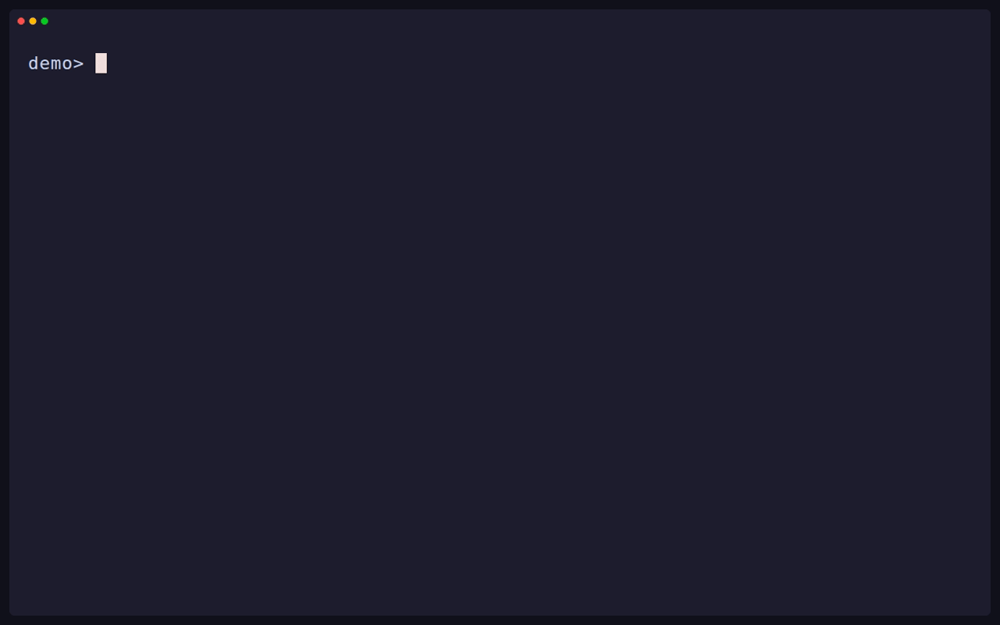

<!--
---
relationships:
  describes: toha
---
-->

# Toha

Generate projects and files from templates.

[](https://github.com/wyrd-company/toha/actions/workflows/ci.yml?query=branch%3Amain)
[](https://github.com/wyrd-company/toha/releases/latest)



Toha is a project scaffolding tool and Rust crate. A template contains an
interview and files to render with Jinja. Toha plans the output before it
writes, so you can inspect a dry run and handle conflicts.

The same interview engine serves terminal users, scripts, agents, and Rust
callers. Scripts and agents can answer one JSON Schema batch at a time and
resume a staged interview in another process.

- One interview for people, scripts, agents, and Rust callers
- Resumable async interviews and headless answers files
- Typed Jinja values and rendered file paths
- `each` file generation and static files
- Template hooks gated by trust
- Git template sources, short names, and aliases
- Embedded agent skills through `toha skills`

Read the [Toha documentation](https://wyrd.tools/docs/toha) for guides and the
full contract.

## Install

Homebrew:

```sh
brew install wyrd-company/tools/toha
```

APT:

```sh
sudo install -d -m 0755 /etc/apt/keyrings
curl -fsSL https://repo.wyrd.foo/pubkey.asc |
  sudo tee /etc/apt/keyrings/wyrd-company.asc >/dev/null
echo "deb [signed-by=/etc/apt/keyrings/wyrd-company.asc] \
https://repo.wyrd.foo/apt stable main" |
  sudo tee /etc/apt/sources.list.d/wyrd-company.list >/dev/null
sudo apt update
sudo apt install toha
```

RPM:

```sh
sudo curl -fsSL https://repo.wyrd.foo/wyrd.repo -o /etc/yum.repos.d/wyrd.repo
sudo dnf install toha
```

Arch Linux (AUR):

```sh
paru -S toha-bin
```

[GitHub Releases](https://github.com/wyrd-company/toha/releases/latest) also
provides Linux and macOS tarballs, Windows zip archives, and `SHA256SUMS` for
direct installation.

## First run

Toha ships a small [demo template](docs/examples/demo/template.yml) inside the
binary. From any directory, offline, with nothing installed:

```sh
toha apply toha-demo ./notes
```

Answer **Note title** and **Topic**. To inspect the file plan without writing
it, use `toha apply toha-demo ./preview --dry-run`.

`toha-demo` is a reserved fallback name. If you install or alias a template as
`toha-demo`, that template resolves instead.

## Using Toha from Rust

Add the library without the CLI dependencies:

```sh
cargo add toha --no-default-features
```

From this repository checkout, drive the same interview with an identity-bearing
answers document. The document names the template it answers, which Toha compares
by exact string equality with the formal name the caller has established before it
evaluates any answer:

```rust
use std::path::Path;
use toha::{Interview, Seed, Template};
use toha::context::{EnvironmentSnapshot, ExecutionFacts, HostFacts, InvocationContext, SelectedTemplate};
use toha::protocol::{self, DocumentStep};
use toha::staging::canonical_target;
let template_root = Path::new("docs/examples/demo").canonicalize().unwrap();
let template = Template::load(&template_root).unwrap();
let expected = template_root.to_str().unwrap();
let target = canonical_target(Path::new("./notes")).unwrap();
let seed = Seed {
    now: "2026-01-01T00:00:00Z[UTC]".parse().unwrap(),
    defaults: Default::default(),
    context: InvocationContext::new(
        target,
        SelectedTemplate::new(expected.into(), template.name.clone(), Vec::new(), None),
        HostFacts::capture(),
        ExecutionFacts::new(false, false),
        EnvironmentSnapshot::Unavailable,
    ).unwrap(),
};
let Interview::Asking(pending) = Interview::start(&template, seed).unwrap() else { panic!("expected questions") };
// The document must name the formal template it answers.
let text = serde_json::json!({
    "template": expected,
    "answers": {"title": "Sample note", "topic": "Research"},
}).to_string();
let DocumentStep::Accepted { interview, .. } =
    protocol::answer_document_once(expected, pending, &text).unwrap()
else { panic!("the document was rejected") };
let Interview::Complete(done) = interview else { panic!("expected complete interview") };
assert_eq!(done.answers.len(), 2);
```

In-memory callers that build answers directly still use `Pending::answer` with
`RawAnswers` and the raw headless walk; the envelope is only for external JSON.

See [CONTRIBUTING.md](CONTRIBUTING.md) for development and changes.


### Application operations

The library also owns template resolution, installed-template transactions,
owned interview replay and project updates. These APIs accept explicit paths
and return data. They do not parse arguments, prompt or print command reports.

- `resolve::Paths` and `resolve::{load_context, resolve_template,
  resume_template}` load configuration, fetch/cache templates and restore pins.
- `catalog::Catalog` loads one registry snapshot. Load a fresh snapshot for each
  mutation; `catalog::{add, list, update, remove, add_alias, remove_alias, trust, untrust}` return
  structured events and errors.
- `operations::Session` owns a loaded template and a serializable `StagedRecord`.
  `state` returns a question document, completion or an ended interview; `answer`
  returns per-question rejections without changing rejected state. `seed_warnings`
  returns dropped application-default warnings as data for the caller to report.
  `plan` and
  `apply` use the existing planner and caller-supplied `HookRunner`.
- `updates::prepare` opens and verifies an update or baseline. `UpdateSession`
  admits current document inputs, pins the application and replays old answers.
  Its question document omits answers already covered by valid recorded values.
  `resume` checks that the pinned application still matches; `apply` accepts
  the caller's runner and preserves staged state on preview or failure.
- `bundled` exposes the offline demo; `assets` lists, reads and exports the
  embedded agent guidance without enabling the CLI feature.

Persist or return the session's `record`, then drop the loaded request. Rebuild
with `Session::resume` or `UpdateSession::resume` for each subsequent request.
The record includes the exact template/base, context, time, document values and
accepted submissions. A bare submissions list does not carry all replay inputs.
Reconstruction does not read new document paths. Inspect `state` before acquiring
new submissions or call `admit_documents` to admit new inputs. `Preparation`
checks requirements and documents before its environment-context admission;
`Session::start` accepts an already captured context. Its `admission_answers`
argument admits document values and parts; `answer`/`answer_all` submit answers.
`persist` owns accepted progress and abort cleanup. Document answers are read
fresh when starting an update and stay fixed within that update session.

Owned request inputs, records and `SessionState` results can cross a worker
boundary. A loaded update retains a thread-local Git repository and is not
`Send` with the current Git dependency features. Construct, consume and drop
that operation inside `spawn_blocking`; return the owned response/record. No
unsafe `Send` implementation or globally shared repository is needed.

`HookRunner::run` receives `PlannedHook` and the absolute target. The hook has
argv/program, target-relative working directory, template root and capture
metadata; the runner returns status and optional raw captured streams. There is
no per-hook environment map. Choose the runner and trust decision explicitly.
Operation-owned reports are silent; runners retain their own I/O contract. The
existing Git SSH transport starts the configured/default `ssh` executable and
can forward SSH diagnostics to stderr. Explicit Toha paths are not process
isolation: gix can read global Git configuration through HOME/XDG, executable
requirements and the process runner use PATH, and applied-record operations
retain the TOHA_RECORD process override.

Run the complete direct-library recipe from a repository checkout:

```sh
task test:consumer
```

[`tests/consumer/src/main.rs`](tests/consumer/src/main.rs) is a separate Cargo
consumer using `default-features = false`. It creates and resumes an interview,
records a generation with a custom hook runner, rebuilds an update inside a
worker thread, admits a fresh document, previews and applies it, preserves
operator edits, removes a part and resolves an older pinned template. It also
exercises template management and embedded assets.

For a reviewed integration commit, Cargo supports a Git dependency with
`git = "https://github.com/wyrd-company/toha"`, the full accepted commit in
`rev`, and `default-features = false`. Use the exact accepted commit from the
handoff; a branch name does not freeze the API. This route does not require a
registry release.
