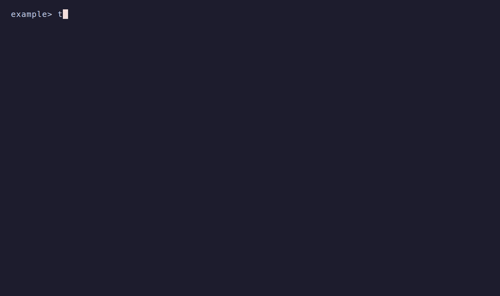

Toha writes `.toha.json` at your repository root when an apply writes files.
Commit it with the generated files. It records the template source and revision,
answers, selected parts, render context and path ownership. Each application has
one entry, identified by its source and repository-relative target. Applying into
`src/example` keeps the record at the repository root.

Set `TOHA_RECORD` to a repository-relative path, such as `.github/toha.json`, to
use another location. Use `/` separators. The path cannot be absolute, contain
`..`, or pass through a symbolic link.



## Update a project

Apply a Git template, then commit the files and record:

```sh
toha apply https://example.invalid/templates/note ./project --answers answers.json
git -C ./project add .
git -C ./project commit -m "Generate project"
```

Use your actual template address. The answers document's `template` must match
the formal name shown by Toha.

Update from that template's recorded application:

```sh
toha apply https://example.invalid/templates/note ./project --update
```

Toha renders the recorded revision again as the **merge base** and merges the
new render with your committed files. It uses whole-file base bytes only when
they match the recorded Git object id. It keeps your edits or reports a
conflict. A path whose base bytes cannot be recovered conflicts when the
candidate differs. Hook output uses its recorded local Git object; Toha does
not rerun old hooks.

Commit or discard changes in the target and record before updating. Use
`--answers FILE` to override recorded answers, `--reanswer` to ask again, or
`--dry-run` to preview. An unchanged render reports `Already current.` and
writes nothing. A new update reads current document inputs or `--input FILE`
and keeps whole recorded documents for the merge base. A staged interview keeps
each document it has accepted until that interview completes.

An agent can stage the update:

```sh
toha stage https://example.invalid/templates/note ./project --update --async
toha continue ./project answers.json
toha apply ./project
```

Staging keeps a copy of the entry. If the entry changes, stage the update again.
When two branches update one application, both change the same record entry.
Resolve a merge conflict by keeping one entry that describes the applied result.

## Re-baseline an application

Use `--baseline` to adopt a project against an empty merge base:

```sh
toha apply ./note-template ./project --baseline --answers answers.json
```

Use this command when there is no applied record, when the recorded revision is
unavailable, or when an unversioned folder template cannot be rendered again.
A repository with old snapshot refs also re-baselines this way. Toha does not
read or migrate those refs.

## Seed another application

`--like` selects the target of an application of the same source:

```sh
toha apply ./note-template ./project/src/second --like src/first --answers answers.json
```

A bare `--like` in a terminal lists applications to choose from. The result
names the selected target. Read or edit `.toha.json` directly to inspect or remove
entries. The [applied record schema](specifications/applied-record-1.schema.yml)
is included in the Toha package; readers can vendor it without a Toha library or
Git plumbing.
