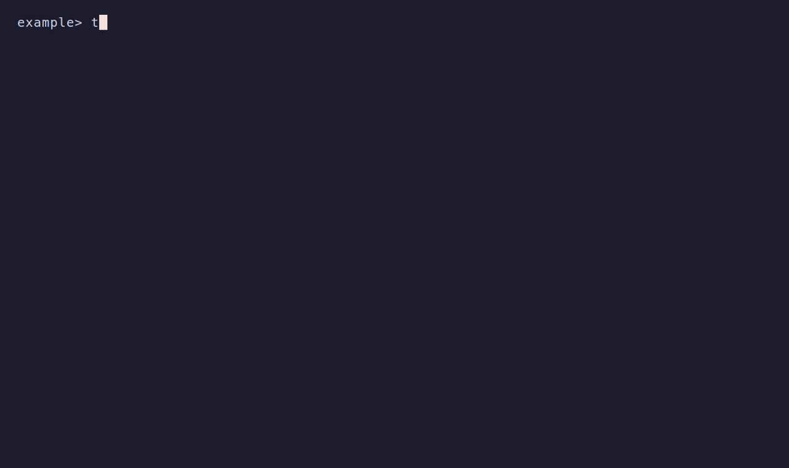

Toha writes `.toha.json` at your repository root when an apply writes files.
Commit it with the generated files. It records the template source and revision,
answers, selected parts, render context and path ownership. Each application has
one entry, identified by its source and repository-relative target. Applying into
`src/example` keeps the record at the repository root.

Set `TOHA_RECORD` to a repository-relative path, such as `.github/toha.json`, to
use another location. Use `/` separators. The path cannot be absolute, contain
`..`, or pass through a symbolic link.



## Update a project

Start a Git repository, apply a Git template, then commit the files and record:

```sh
git init ./project
toha apply https://example.invalid/templates/note ./project --answers answers.json
git -C ./project add .
git -C ./project commit -m "Generate project"
```

Use your actual template address. The answers document's `template` must match
the formal name shown by Toha.

Update from that template's recorded application:

```sh
toha apply https://example.invalid/templates/note ./project --update
```

Toha renders the recorded revision again as the **merge base** and merges the
new render with your committed files. It uses whole-file base bytes only when
they match the recorded Git object id. It keeps your edits or reports a
conflict. A path whose base bytes cannot be recovered conflicts when the
candidate differs. Hook output uses its recorded local Git object; Toha does
not rerun old hooks.

For a file managed through bounded edits, an edit inside its managed region
refuses the update before any project file, index or record write. This also applies when the template changes only an
unrelated file, removes that region, or supplies a whole file that covers it.
To replace or retract that edited block, retry the same apply command with
`--force`. For a staged update, use `toha apply ./project --force`; the refused
update keeps its stage. Force preserves edits outside the injected block and
does not repair invalid markers or missing anchors. `--dry-run --force` previews
that replacement without writing or granting force to a later apply. Ordinary
whole-file updates still use the three-way merge, and owned JSON values converge
without force.

When a file changes from bounded edits to whole-file ownership, Toha compares
its committed content with previously owned edits removed against the planned
whole-file content with previous and new owned edits removed. Those bytes must
match. An absent committed file contributes empty outside content, so a
committed deletion conflicts with non-empty planned outside content even with
force. If the planned file has no managed blocks or values, its whole content
is compared. A mismatch can occur without an operator change: lines previously
inside a managed block can appear as ordinary text in the planned whole file.
The transition then conflicts, even if the old region is undrifted or you use
`--force`.

To continue, restore or edit the listed project files so their content outside
previously owned edits matches the planned whole-file content outside its owned
edits. Commit those changes, then retry the same apply command. For example, if a formerly managed
line becomes ordinary text in the planned file, retain that line as ordinary
text in the project file by removing its old region markers. Force cannot
resolve this outside-content conflict. Files already owned as whole files
retain their three-way merge.

Commit or discard changes in the target and record before updating. Use
`--answers FILE` to override recorded answers, `--reanswer` to ask again, or
`--dry-run` to preview. An unchanged render reports `Already current.` and
leaves your files, index, applied record and refs unchanged. Update preparation
can write internal Git objects. A new update reads current document inputs or
`--input FILE` and keeps whole recorded documents for the merge base. A staged
interview keeps each document it has accepted until that interview completes.

Updates compare historical line endings under current Git attributes. Read-only
comparison hashes normalized bytes without storing a comparison blob. Comparison
and in-memory merge-input normalization skip the `core.safecrlf` check-in check;
candidate capture and the write transaction retain the repository policy.

An agent can stage the update:

```sh
toha stage https://example.invalid/templates/note ./project --update --async
toha continue ./project answers.json
toha apply ./project
```

Staging keeps a copy of the entry. If the entry changes, stage the update again.
When two branches update one application, both change the same record entry.
Resolve a merge conflict by keeping one entry that describes the applied result.

## Add or remove parts

A template can mark one `multiselect` question with `parts: true`. Its options
name the parts. The template uses that answer in file bodies, paths, conditions,
injections and hooks. For example:

```yaml
interview:
  - id: targets
    type: multiselect
    parts: true
    prompt: Select parts
    options: [core, extra]
    default: [core]
```

Add or remove parts with repeatable flags:

```sh
toha apply https://example.invalid/templates/note ./project --update --with extra
git -C ./project add .
git -C ./project commit -m "Add extra part"
toha apply https://example.invalid/templates/note ./project --update --without extra
```

On a fresh apply, the flags change the question's default; `--like` uses the
seed application's parts. On an update, they change the recorded selection when
the applied revision had a part question. Without flags, updates replay that
selection, including an empty selection. A part question first added by the new
revision is asked; `--with` and `--without` change its default instead.
`--reanswer` asks the part question again unless a part flag settles it. Do not
also answer that question in an answers document when a part flag is present.

Selections render in option order. Unknown parts, a part named by both flags,
and flags on a template without a part question are usage errors. The settled
answer must meet the question's required, minimum and maximum constraints.

Removing a part deletes its unmodified whole files. An edited file has a
modify/delete conflict. Shared files merge through the same three-way update;
injections retract their owned content and then release the path. Commit the
result and `.toha.json`. Scripted results include `application.parts_added` and
`application.parts_removed`, plus `prior_revision` and `resolved_revision`.
Person summaries show the same information. Staging preserves the flags and
the selection they change.

## Re-baseline an application

Use `--baseline` to adopt a project against an empty merge base:

```sh
toha apply ./note-template ./project --baseline --answers answers.json
```

Use this command when there is no applied record, when the recorded revision is
unavailable, or when an unversioned folder template cannot be rendered again.
A repository with old snapshot refs also re-baselines this way. Toha does not
read or migrate those refs. Resolve any conflicts, commit the re-baselined files
and record, and check the result before removing old refs.

Inspect the old refs with Git:

```sh
git -C ./project for-each-ref --format='%(refname)' refs/toha/snapshots/
```

To remove one, pass its full name from that list to Git:

```sh
git -C ./project update-ref -d refs/toha/snapshots/<id>
```

Replace `<id>` with the actual ref suffix. This deletes that local ref; it does
not remove a ref from a remote repository.

## Seed another application

`--like` selects the target of an application of the same source:

```sh
toha apply ./note-template ./project/src/second --like src/first --answers answers.json
```

A bare `--like` in a terminal lists applications to choose from. The result
names the selected target. Read or edit `.toha.json` directly to inspect or remove
entries. The [applied record schema](https://github.com/wyrd-company/toha/blob/main/docs/specifications/applied-record-1.schema.yml)
is included in the Toha package; readers can vendor it without a Toha library or
Git plumbing.
